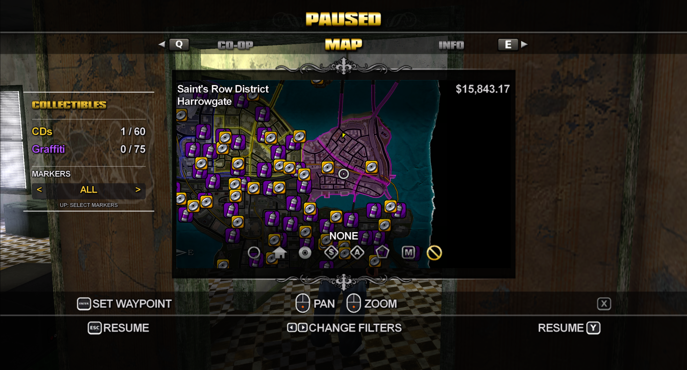

# Collectibles Tracker for Saints Reborn

Track missing CDs and graffiti in [Saints Reborn](https://github.com/whompay/SaintsReborn).

[Download the latest release](https://github.com/kxrxh/SaintsReborn-Collectibles/releases/latest)



## Features

- Shows **CDs / 60** and **Graffiti / 75** beside the map.
- Marks missing collectibles on the full map and nearby ones on the minimap.
- Uses yellow CD icons and purple spray-can icons.
- Choose **All**, **CDs**, **Graffiti** or **Off** with the map-side selector.
- Uses the game's menu fonts and follows the map's open/close animation.
- Updates completion from the loaded save and hides collected locations.

The mod reads locations from your own game files. It does not collect items, change save progress or replace your waypoint. Single-player only.

## Install

1. Download `SaintsReborn-Collectibles-v0.3.0.zip` from [Releases](https://github.com/kxrxh/SaintsReborn-Collectibles/releases/latest).
2. Close the game.
3. Extract the `CollectiblesTracker` folder into `SaintsReborn/dist/mods/`.
4. Open **Whompay's Mod Loader**, enable **Collectibles Tracker** and press **Play**.

The result should look like this:

```text
SaintsReborn/
  dist/
    mods/
      CollectiblesTracker/
        CollectiblesTracker.dll
        mod.ini
        assets/
          ui-atlas.bin
```

No compiling is needed to play. Load your normal save and open the map with **M**.

## Controls

- **Mouse:** move to the Markers selector and click its left or right side.
- **Keyboard arrows / controller D-pad:** press **Up** to select Markers, then **Left/Right** to change the mode. Press **Down** to return to the normal map filters.

Counts remain visible with markers off. Minimap icons appear only when the whole badge fits inside the radar. Selector clicks do not place waypoints; tab switching and closing the map keep their normal controls.

Set `markers` in `mod.ini` to choose the initial mode: `0` off, `1` CDs, `2` graffiti, `3` all.

## Compatibility and removal

Tested on Saints Reborn V1.2.2 / source `b81a18a`, using its bundled Whompay's Mod Loader. An update that changes native game addresses or the SDK context layout may require a new mod build. Multiplayer is excluded.

To disable the tracker, untick it in the mod loader and restart. To remove it, close the game and delete its `CollectiblesTracker` folder. Your saves are unchanged.

## Troubleshooting

Check `dist/mods/wml.log` for lines beginning with `[Collectibles Tracker]`. If icons are missing, check that `assets/ui-atlas.bin` was extracted with the DLL. Location and progress checks use your installed game files; the mod logs an error if they cannot be read.

## Build from source

Requires Visual Studio 2022 C++ Build Tools and a Saints Reborn source/build installation with its WML, ReXGlue SDK and zlib build files.

```powershell
.\Build.ps1 -GameRoot "C:\Games\SaintsReborn"
.\Build.ps1 -GameRoot "C:\Games\SaintsReborn" -Test
```

The tests cover location parsing, completion filtering, map/minimap rendering, radar bounds, selector input, navigation pass-through and CPU context, stack, color and native icon-list restoration.

To rebuild the UI atlas from the included PNGs, run `python BakeAssets.py` with Pillow installed. The asset baker reads no game files.

## Credits and license

Author: **kxrxh**. Built for Saints Reborn and Whompay's Mod Loader by whompay, using the ReXGlue SDK and zlib. See [third-party notices](THIRD_PARTY_NOTICES.md).

The mod's source and original icon artwork are available under the [MIT License](LICENSE). No Saints Row game files or extracted location tables are included.
